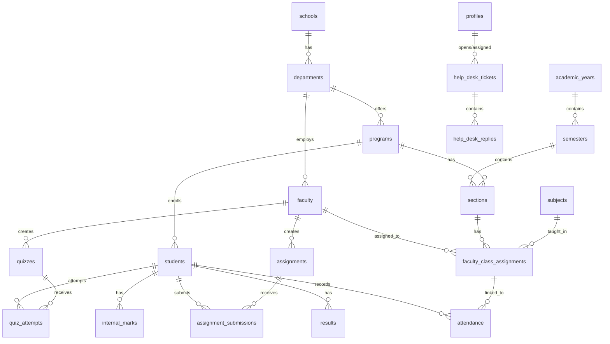

# MRUH ERP Database Documentation

## 1. Overview
The MRUH ERP system uses PostgreSQL (managed by Supabase) as its core relational database. The schema is heavily normalized to ensure data integrity across the educational lifecycle (from Schools/Colleges down to individual marks and attendance).

Row Level Security (RLS) is strictly enforced on every table.

## 2. Entity-Relationship (ER) Diagram

## 3. Core Tables Documentation

### 3.1. `profiles`
- **Purpose:** Stores the core identity, authorization role, and authentication linkage for every user.
- **Primary Key:** `id` (UUID, references `auth.users(id)`)
- **Foreign Keys:** None directly, but referenced heavily by `students`, `faculty`, and `help_desk`.
- **Columns:** `id`, `role`, `full_name`, `email`, `avatar_url`, `created_at`, `updated_at`.
- **RLS Policies:** Users can read their own profile; Admins can read/manage all.
- **Modules Using:** Authentication, Middleware, Help Desk, Profile Settings.

### 3.2. `schools` & `departments`
- **Purpose:** Defines the organizational hierarchy (e.g., School of Engineering -> Computer Science Dept).
- **Primary Keys:** `id` (UUID)
- **Foreign Keys:** `departments.school_id` -> `schools.id`
- **RLS Policies:** Publicly readable by authenticated users. Admins manage.
- **Modules Using:** Admin settings, User creation.

### 3.3. `students` & `faculty`
- **Purpose:** Extends the `profiles` table with role-specific academic and employment data.
- **Primary Keys:** `id` (UUID, references `profiles(id)`)
- **Foreign Keys:** 
  - `students.program_id` -> `programs.id`
  - `faculty.department_id` -> `departments.id`
- **Indexes:** Indexed on `enrollment_number` and `employee_id`.
- **RLS Policies:** Self-read, Faculty-read for students they teach, Admin full access.
- **Modules Using:** Student Dashboard, Faculty Directory, HOD Reports, Bulk Import.

### 3.4. `sections` & `faculty_class_assignments`
- **Purpose:** Ties together Students, Faculty, Subjects, and Time. Represents a physical/logical class block.
- **Primary Keys:** `id` (UUID)
- **Foreign Keys:** `program_id`, `semester_id`, `subject_id`, `faculty_id`, `section_id`.
- **RLS Policies:** Readable by assigned faculty and enrolled students.
- **Modules Using:** Timetable generation, Attendance tracking, Internal Marks entry.

### 3.5. `attendance`
- **Purpose:** Records daily/lecture-based student attendance.
- **Primary Keys:** `id` (UUID)
- **Foreign Keys:** `student_id`, `assignment_id` (faculty_class_assignments).
- **Indexes:** Indexed by `date` and `student_id`.
- **RLS Policies:** Students can read own; Faculty can read/write for their assignments.
- **Modules Using:** Faculty Attendance Module, Student Dashboard, HOD Reports.

### 3.6. `assignments` & `assignment_submissions`
- **Purpose:** Tracks assignments created by faculty and the files submitted by students.
- **Foreign Keys:** `faculty_id`, `section_id`, `subject_id`, `student_id`.
- **Modules Using:** Learning Management System (LMS) modules.

### 3.7. `internal_marks` & `results`
- **Purpose:** Stores continuous assessment (internals) and final end-semester grades/SGPA.
- **Foreign Keys:** `student_id`, `subject_id`, `semester_id`.
- **RLS Policies:** Faculty can upload; Students can view published results only.
- **Modules Using:** Examination Module, Student Results Viewer.

### 3.8. Enterprise Modules (`help_desk_tickets`, `audit_logs`, `announcements`)
- **Purpose:** Provides organizational wide features like ticketing and global alerts.
- **Modules Using:** Help Desk, Admin Dashboard, Global Notifications system.
