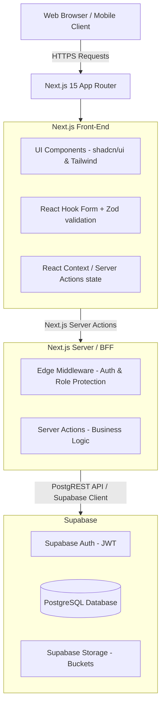

# MRUH ERP System Architecture

## 1. Overview
The MRUH ERP system is a modern, full-stack educational enterprise resource planning system. It employs a serverless, decoupled architecture using Next.js 15 App Router as the front-end and BFF (Backend-For-Frontend), communicating directly with a Supabase PostgreSQL backend.

## 2. High-Level Architecture


## 3. Core Technologies
- **Framework:** Next.js 15 (React 19, TypeScript)
- **Styling:** Tailwind CSS, shadcn/ui (Radix UI primitives)
- **Validation:** Zod schemas
- **Form Handling:** React Hook Form
- **Authentication:** Supabase Auth (Email/Password, JWT)
- **Database:** PostgreSQL (managed by Supabase)
- **File Storage:** Supabase Storage
- **Deployment:** Vercel (Front-end), Supabase (Backend/DB)

## 4. Folder Structure (Monolithic Repo)
```
college-erp/
├── docs/                 # Project documentation
├── public/               # Static assets (images, fonts, robots.txt)
├── scripts/              # Database migration and utility scripts
├── src/
│   ├── app/              # Next.js 15 App Router routes
│   │   ├── (auth)/       # Public authentication routes
│   │   └── (dashboard)/  # Role-based dashboard routes
│   ├── components/       # Reusable UI elements (shadcn, layout, data-tables)
│   ├── config/           # App configuration (navigation, constants)
│   ├── features/         # Feature-based Server Actions and domain logic
│   ├── hooks/            # Custom React hooks
│   ├── lib/              # Utility functions, Supabase clients
│   └── types/            # Global TypeScript definitions
├── supabase/
│   └── migrations/       # Database SQL migrations and schema
├── .env.example          # Environment variables template
├── tailwind.config.ts    # Tailwind theme configuration
├── tsconfig.json         # TypeScript compiler configuration
└── package.json          # Node dependencies and scripts
```

## 5. Security & Authentication Flow
MRUH ERP relies on Supabase Auth (JWT) combined with Next.js Middleware.
1. User submits login credentials to `/login`.
2. Supabase verifies credentials and returns a secure HTTP-only session cookie containing a JWT.
3. Next.js **Middleware** intercepts every request:
   - Validates the session cookie.
   - Decodes the user's role from the JWT or Database Profile.
   - Checks if the user is authorized for the requested route (e.g., `/admin/*` requires `admin` role).
   - Redirects unauthorized users.
4. **Row Level Security (RLS)** in PostgreSQL provides the final layer of security, ensuring a user cannot query data they do not own, even if they bypass the application layer.

## 6. Server Actions & Feature Modules
Business logic is organized by feature (e.g., `src/features/attendance/actions.ts`). 
- **Decoupling:** Server actions act as internal APIs, removing the need for a dedicated REST or GraphQL API layer.
- **Type Safety:** The entire request/response cycle is heavily typed using TypeScript, catching schema mismatches at compile time.

## 7. Role Management
The system defines 5 strict roles:
1. `admin`: System-wide access, creates initial data, manages schedules.
2. `faculty`: Manages assignments, attendance, internal marks.
3. `student`: Views schedules, materials, submits assignments, views marks.
4. `hod`: Overlooks department metrics, faculty performance, department timetables.
5. `placement`: Manages campus drives and corporate relations.
