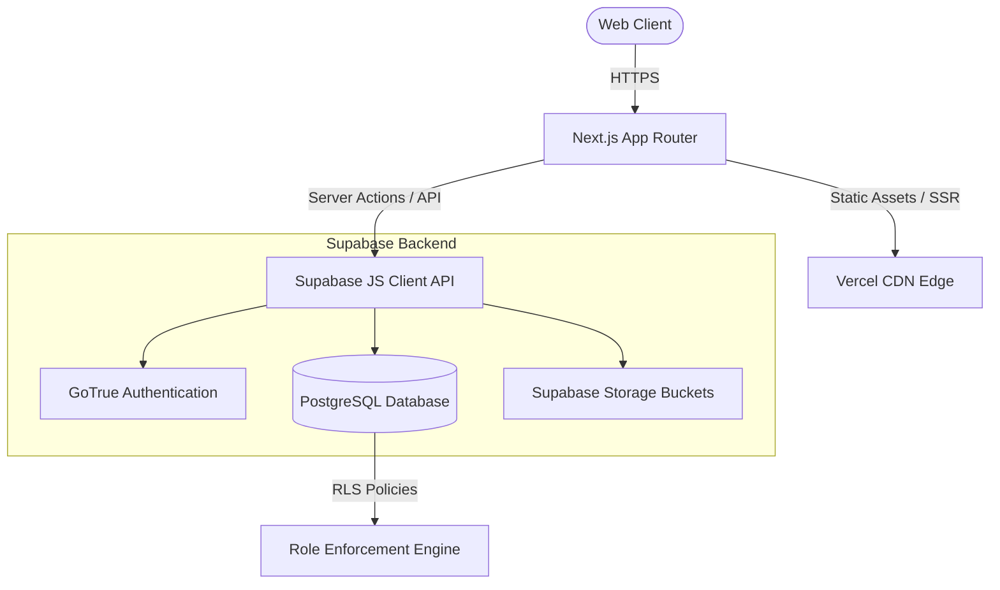
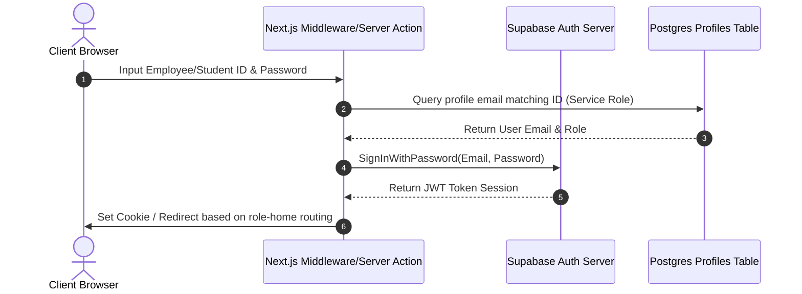
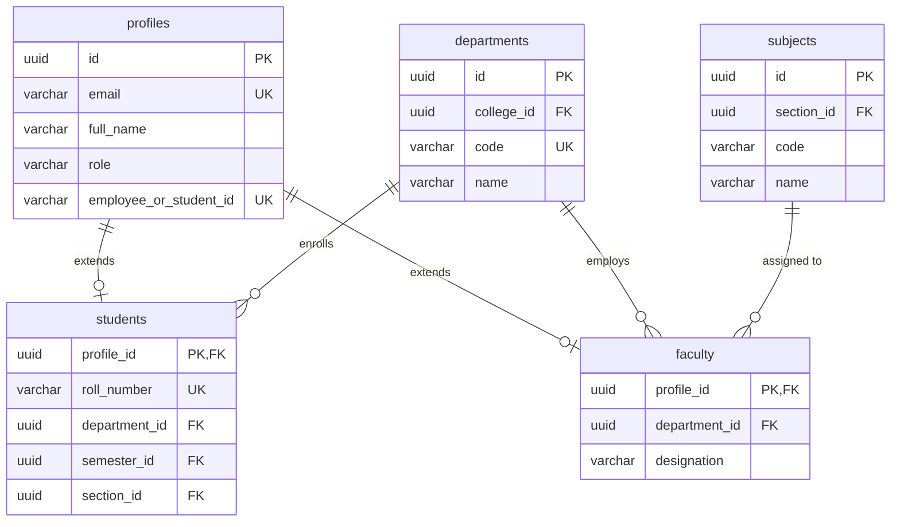

# System Diagrams & Documentation

This directory contains visual mappings of the system's database relationships, authentication configurations, and architectural layout.

## 1. System Architecture Diagram

---

## 2. Authentication Flow Diagram

---

## 3. Entity-Relationship (ER) Diagram

